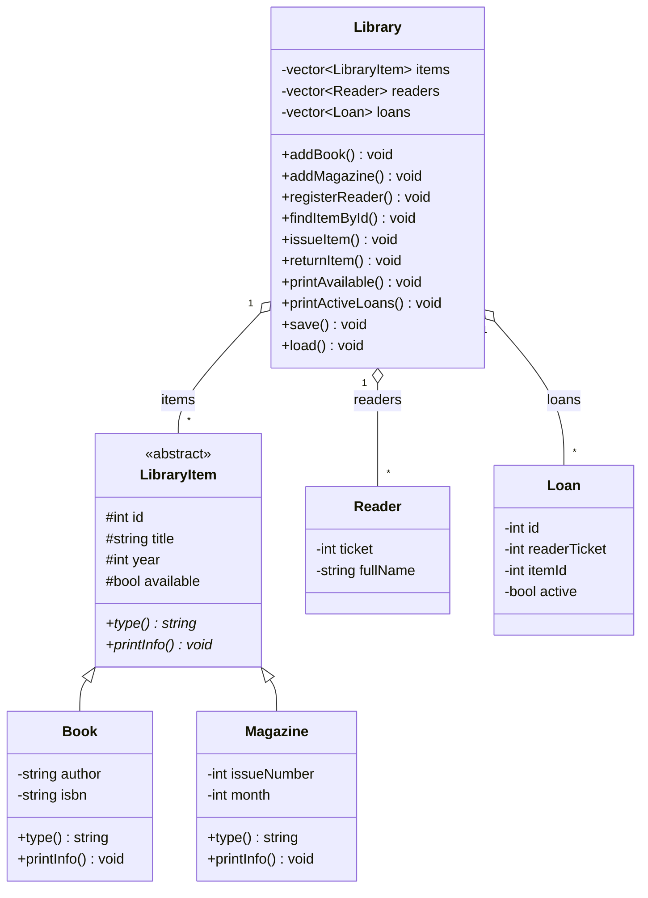

# Диаграмма классов «Библиотека колледжа» (УП3)

`<|--` означает наследование, `o--` означает, что `Library` хранит коллекцию объектов.

## Словарь полей

| Класс | Поле | Тип | Описание |
|-------|------|-----|----------|
| LibraryItem | id | int | Уникальный идентификатор издания |
| | title | string | Название |
| | year | int | Год издания (1500-2100) |
| | available | bool | Признак наличия в библиотеке |
| Book | author | string | Автор |
| | isbn | string | ISBN |
| Magazine | issueNumber | int | Номер выпуска |
| | month | int | Месяц (1-12) |
| Reader | ticket | int | Уникальный номер читательского билета |
| | fullName | string | ФИО читателя |
| Loan | id | int | Уникальный идентификатор выдачи |
| | readerTicket | int | Номер билета читателя (ссылка на `Reader`) |
| | itemId | int | id выданного издания (ссылка на `LibraryItem`) |
| | active | bool | Выдача активна (true) или закрыта (false) |
| Library | items | vector<unique_ptr<LibraryItem>> | Коллекция изданий |
| | readers | vector<Reader> | Коллекция читателей |
| | loans | vector<Loan> | Коллекция выдач |
